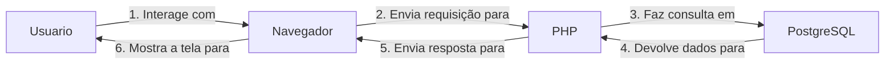
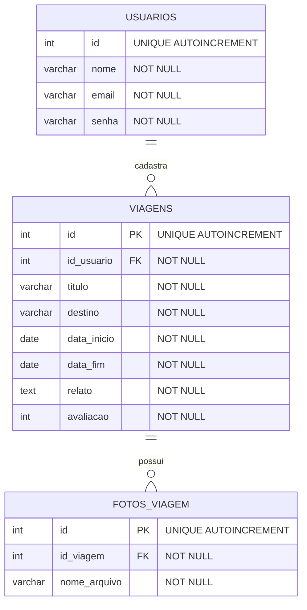

# Travelly — Especificação de Requisitos de Software (SRS/ERS)

**Sistema:** Travelly — Diário de Viagens  
**Tipo de documento:** Especificação de Requisitos de Software (SRS/ERS)  
**Referência de estrutura:** ISO/IEC/IEEE 29148:2018  
**Versão:** 1.3
**Data:** Outubro de 2026  
**Curso:** Técnico em Desenvolvimento de Sistemas — SENAI  
**Tecnologias utilizadas:** PHP, PostgreSQL, HTML e CSS

---

# 1. Introdução

## 1.1. Propósito

Este documento especifica os requisitos funcionais e não funcionais do Travelly, uma aplicação web desenvolvida para funcionar como um diário digital de viagens. O documento descreve as funcionalidades esperadas, as regras de negócio, os dados utilizados, os fluxos de navegação e os critérios que podem ser empregados na verificação do sistema.

A especificação tem como objetivos:

- Padronizar o entendimento sobre o funcionamento do Travelly;
- Registrar os recursos disponíveis e os limites do sistema;
- Servir como referência para desenvolvimento, testes e manutenção;
- Apoiar a identificação de falhas e a evolução do projeto;
- Relacionar requisitos, regras de negócio e critérios de aceitação.

## 1.2. Escopo do produto

O Travelly permite que pessoas interessadas em viagens criem uma conta, façam login e mantenham registros pessoais de suas experiências. Após a autenticação, o usuário pode administrar suas viagens ao cadastrar novos registros, visualizar relatos já cadastrados, pesquisar viagens, atualizar informações e excluir registros.

O sistema também possui gerenciamento de perfil. O usuário pode consultar e atualizar suas informações e solicitar a exclusão da própria conta. A sessão pode ser encerrada por meio da opção de logout.

## 1.3. Contexto e problema

Experiências de viagem podem ficar registradas em diferentes lugares, como anotações, arquivos e aplicativos. Quando esses registros ficam dispersos, pode ser mais difícil consultar informações de viagens anteriores e manter um histórico organizado.

O Travelly, então, propõe reunir esses registros em uma plataforma web, permitindo que cada usuário mantenha um histórico próprio e possa recuperar ou modificar suas informações quando necessário.

## 1.4. Definições e acrônimos

| Termo | Definição |
|---|---|
| Travelly | Sistema web de diário de viagens descrito neste documento. |
| CRUD | Sigla de *Create, Read, Update and Delete*: criar, consultar, atualizar e excluir registros. |
| DER | Diagrama Entidade-Relacionamento, utilizado para representar entidades e relacionamentos do banco de dados. |
| RF | Requisito Funcional. |
| RNF | Requisito Não Funcional. |
| RN | Regra de Negócio. |

---

# 2. Descrição geral do sistema

## 2.1. Perspectiva do produto

O Travelly é uma aplicação web conectada a um banco de dados PostgreSQL. A interface permite que o usuário interaja com o sistema por meio de páginas e formulários. O PHP processa as requisições, aplica validações e regras de negócio, e realiza as operações no banco de dados.

Visão simplificada da arquitetura:


## 2.2. Funções principais

O sistema permite ao usuário:
- Criar um usuário para si mesmo;
- Realizar login e logout;
- Cadastrar relatos de suas viagens;
- Listar e visualizar suas viagens;
- Pesquisar suas viagens cadastradas;
- Editar suas viagens existentes;
- Excluir suas viagens;
- Consultar e atualizar informações do seu perfil;
- Realizar a exclusão da própria conta.

## 2.3. Classes de usuários

| Tipo de usuário | Descrição | Permissões esperadas |
|---|---|---|
| Visitante | Pessoa que ainda não entrou em uma sessão autenticada. | Acessar telas públicas, ou seja, realizar cadastro ou login. Não possui acesso a páginas privadas, como as de adicionar, visualizar ou excluir registros. |
| Usuário autenticado | Pessoa que entrou no sistema com credenciais válidas. | Gerenciar as próprias viagens e informações de perfil, além de encerrar a sessão. |
| Responsável pela manutenção | Pessoa que desenvolve ou mantém o projeto. | Atua sobre o código e o ambiente de execução. Não implica a existência de um perfil administrativo dentro da aplicação. |

---

# 3. Requisitos do sistema

## 3.1. Convenção e prioridade

Os requisitos são identificados como `RF-XXX` e `RNF-XXX`. A prioridade está classificada como:

- **Alta:** essencial ao objetivo principal ou à segurança do sistema.
- **Média:** importante para completar a experiência e a consistência do uso.
- **Baixa:** melhoria de qualidade que não impede o funcionamento básico.

---

## 3.2. Requisitos funcionais

### Cadastro e autenticação

#### RF-001 — Cadastro de usuário
**Prioridade:** Alta  
**Descrição:** o sistema deve permitir que uma pessoa crie uma conta por meio de um formulário de cadastro.

**Critérios de aceitação:**
- O nome, o e-mail e a senha devem ser solicitados conforme o formulário de cadastro;
- Os campos obrigatórios devem ser validados;
- O e-mail não deve ser aceito se já estiver cadastrado, ou seja, se já houver um cadastro com aquele mesmo e-mail;
- A senha deve ser armazenada em formato de hash, nunca em texto puro, para garantir a segurança do usuário;
- O sistema deve apresentar retorno de sucesso ou falha.

#### RF-002 — Validação dos dados de cadastro
**Prioridade:** Alta  
**Descrição:** o sistema deve validar os dados recebidos antes de criar uma conta.

**Critérios de aceitação:**
- Entradas obrigatórias vazias devem ser recusadas;
- Dados inválidos devem gerar mensagem de erro;
- O campo de nome deve conter apenas letras e espaços.

#### RF-003 — Login
**Prioridade:** Alta  
**Descrição:** o sistema deve permitir que uma pessoa cadastrada entre na plataforma com suas credenciais.

**Critérios de aceitação:**
- As credenciais informadas (e-mail e senha) devem ser verificadas no banco de dados;
- Credenciais inválidas devem ser recusadas;
- A mensagem de erro não deve revelar informações sobre a existência prévia do e-mail ou dados de outros usuários.

#### RF-004 — Proteção das páginas privadas
**Prioridade:** Alta  
**Descrição:** o sistema deve restringir o acesso às páginas internas e operações de viagens e perfil apenas a usuários autenticados.

**Critérios de aceitação:**
- O acesso às funções internas do sistema é permitido apenas para usuários que fizeram login;
- O código da aplicação deve sempre checar se o usuário está logado antes de carregar qualquer página privada (via `verifica_user.php`).
- Uma tentativa de acesso não autorizado deve ser bloqueada e redirecionada para a página inicial (index.php).

#### RF-005 — Logout
**Prioridade:** Alta  
**Descrição:** o sistema deve disponibilizar uma operação para encerrar a sessão do usuário.

**Critérios de aceitação:**
- O encerramento da conta (logout) deve destruir a sessão ativa do usuário no servidor de forma definitiva;
- Após o logout, o uso do botão "Voltar" do navegador não deve permitir visualizar dados das páginas privadas;
- O usuário deve ser redirecionado para a página inicial.

---

### Gerenciamento de viagens

#### RF-006 — Cadastrar viagem
**Prioridade:** Alta  
**Descrição:** o sistema deve permitir que o usuário autenticado crie um novo relato de viagem com fotos.

**Critérios de aceitação:**
- Disponibilizar formulário completo para preenchimento dos dados da viagem (destino, datas, relato, nota de 0 a 5 e fotos (opcional);
- Validar o campo destino para permitir somente letras e espaços;
- Definir uma imagem padrão (sem_imagem.png) quando o usuário não anexar nenhuma foto;
- Salvar as informações no banco de dados (PostgreSQL) associadas ao usuário autenticado;
- Exibir mensagem de retorno confirmando o sucesso ou a falha da ação.

#### RF-007 — Listar viagens
**Prioridade:** Alta  
**Descrição:** o sistema deve apresentar as viagens cadastradas pertencentes ao usuário autenticado.

**Critérios de aceitação:**
- Carregar as viagens cadastradas a partir de consultas ao banco de dados;
- Exibir cada registro mostrando o destino, data, nota e imagem de capa;
- Filtrar os resultados para que cada usuário veja somente os seus próprios registros;
- Apresentar uma mensagem quando a conta não possuir viagens registradas.

#### RF-008 — Visualizar detalhes da viagem
**Prioridade:** Média  
**Descrição:** o sistema deve permitir a consulta detalhada de todas as informações de um relato selecionado.

**Critérios de aceitação:**
- Exibir todos os dados do relato (título, destino, relato completo, nota, datas e fotos);
- O botão "Voltar" da tela de detalhes deve retornar o usuário para a página exata de onde veio (`inicio`, `viagens`, `pesquisar` ou `atualizar`);
- Validar no banco de dados se a viagem pertence ao usuário ativo na sessão antes de carregar o conteúdo.

#### RF-009 — Pesquisar viagens
**Prioridade:** Alta  
**Descrição:** o sistema deve permitir que o usuário filtre suas viagens por meio de um campo de busca por destino.

**Critérios de aceitação:**
- A pesquisa deve procurar o texto digitado dentro do destino da viagem, sem diferenciar letras maiúsculas de minúsculas ou palavras incompletas;
- A busca deve mostrar apenas as viagens que pertencem à própria pessoa que está logada;
- Se nada for encontrado, o sistema deve exibir a mensagem: "Nenhuma viagem encontrada para este destino";

#### RF-010 — Editar viagem
**Prioridade:** Alta  
**Descrição:** o sistema deve permitir que o usuário atualize as informações e adicione novas fotos de um relato já cadastrado.

**Critérios de aceitação:**
- Ao abrir a tela de edição, os dados antigos da viagem já devem vir preenchidos nos campos;
- As novas informações digitadas devem ser checadas pelo sistema antes de salvar;
- Se a pessoa enviar novas fotos, elas devem ser adicionadas à viagem sem ultrapassar o limite total de 10 fotos;
- Apenas o dono da viagem pode alterar as informações;
- As alterações devem ser salvas no banco de dados e atualizadas na tela na mesma hora.

#### RF-011 — Excluir viagem
**Prioridade:** Alta  
**Descrição:** o sistema deve permitir que o usuário remova permanentemente um relato de viagem.

**Critérios de aceitação:**
- O sistema deve pedir uma confirmação antes de apagar a viagem para evitar que a pessoa exclua por engano;
- O sistema só deve permitir a exclusão se a viagem realmente pertencer à pessoa que está logada;
- Ao apagar a viagem, o registro é removido do banco de dados e os arquivos das fotos são deletados;
- A viagem excluída deve sumir da tela imediatamente e não aparecer mais em nenhuma opção.

---

### Perfil do usuário

#### RF-012 — Consultar perfil
**Prioridade:** Média  
**Descrição:** o sistema deve permitir que o usuário autenticado visualize as informações de sua conta.

**Critérios de aceitação:**
- As informações mostradas na tela devem ser exatamente as da pessoa que está logada;
- Dados protegidos, como a senha codificada (hash), não devem aparecer na tela.

#### RF-013 — Atualizar perfil
**Prioridade:** Alta  
**Descrição:** o sistema deve permitir que o usuário altere seus dados cadastrais.

**Critérios de aceitação:**
- O formulário de alteração já deve aparecer preenchido com as informações atuais da pessoa;
- O sistema deve checar os novos dados digitados antes de salvar as alterações;
- Se a pessoa trocar de e-mail, o sistema deve conferir se o novo e-mail já não pertence a outro usuário cadastrado;
- As alterações salvas no banco de dados devem atualizar na hora as informações da conta logada.

#### RF-014 — Excluir conta
**Prioridade:** Alta  
**Descrição:** o sistema deve permitir que o usuário exclua permanentemente o seu perfil da plataforma.

**Critérios de aceitação:**
- O sistema deve identificar qual conta apagar usando apenas a sessão ativa ($_SESSION);
- O sistema deve pedir uma confirmação da pessoa antes de deletar a conta;
- Ao apagar o perfil, o sistema deve fazer a exclusão completa: apagar o cadastro do usuário, todas as suas viagens no banco e todos os arquivos de foto salvos na pasta uploads;
- Depois de apagar tudo, o sistema deve encerrar a sessão e mandar o usuário de volta para a tela inicial (index.php).

#### RF-015 — Feedback das operações
**Prioridade:** Média  
**Descrição:** o sistema deve informar claramente o resultado de todas as ações executadas pelo usuário.

**Critérios de aceitação:**
- Avisos de sucesso só devem aparecer depois que as informações forem realmente salvas no banco de dados;
- Mensagens de erro devem usar um texto claro e fácil de entender (ex.: "Você só pode adicionar até 10 imagens por viagem!");
- O sistema não deve mostrar detalhes técnicos ou erros do código (como comandos de SQL ou mensagens de erro do PHP) para o usuário.

---

## 3.3. Requisitos não funcionais

#### RNF-001 — Armazenamento seguro de senhas
**Prioridade:** Alta  
**Descrição:** as senhas dos usuários devem ser armazenadas de forma segura utilizando funções de criptografia hash (`password_hash()` e `password_verify()`).

#### RNF-002 — Proteção e Segurança do Banco de Dados
**Prioridade:** Alta  
**Descrição:** O sistema deve tratar todos os dados digitados pelos usuários utilizando consultas parametrizadas, garantindo que nenhum comando não autorizado seja executado no banco de dados..

#### RNF-003 — Armazenamento de imagens
**Prioridade:** Alta  
**Descrição:** O sistema deve salvar todas as fotos enviadas dentro da pasta uploads/, alterando automaticamente o nome de cada arquivo para um código exclusivo antes de salvar no disco, evitando que uma imagem apague outra de mesmo nome.

#### RNF-004 — Relacionamento do Banco de Dados
**Prioridade:** Alta  
**Descrição:** O PostgreSQL deve manter os dados permanentemente conectados e organizados entre as tabelas do sistema usando chaves estrangeiras (FOREIGN KEY), garantindo que nenhuma foto ou viagem exista sem um usuário dono vinculado.

---

# 4. Regras de Negócio

As regras de negócio definem as restrições, validações e comportamentos que o **Travelly** deve seguir obrigatoriamente para manter a segurança e a integridade dos dados no banco de dados PostgreSQL:

### RN-001 — Unicidade de E-mail
* **Descrição:** Cada endereço de e-mail só pode estar associado a uma única conta no sistema.
* **Comportamento:** O sistema deve verificar se o e-mail informado no cadastro ou na atualização de perfil já existe no banco de dados. Caso exista, o cadastro deve ser recusado e uma mensagem de aviso deve ser exibida.

### RN-002 — Criptografia de Senha
* **Descrição:** Nenhuma senha pode ser salva em texto normal no banco de dados.
* **Comportamento:** Todas as senhas devem ser criptografadas utilizando a função `password_hash()` do PHP antes de serem salvas na coluna `senha` da tabela `usuarios`. A verificação no login deve utilizar `password_verify()`.

### RN-003 — Isolamento e Propriedade dos Dados
* **Descrição:** O usuário só tem permissão para visualizar, editar ou excluir as suas próprias viagens e fotos.
* **Comportamento:** Todas as consultas no banco de dados (`SELECT`, `UPDATE`, `DELETE`) em registros de viagem devem filtrar obrigatoriamente pelo `id_usuario` armazenado na sessão ativa (`$_SESSION`). Tentativas de acessar IDs de viagens pertencentes a outros usuários devem ser bloqueadas.

### RN-004 — Exclusão em Cascata
* **Descrição:** A remoção de um registro pai deve excluir automaticamente todos os registros filhos associados no banco de dados (`ON DELETE CASCADE`).
* **Comportamento:**
  * Se um usuário excluir sua conta (`usuarios`), o PostgreSQL remove automaticamente todas as suas viagens (`viagens`) e fotos (`fotos_viagem`).
  * Se uma viagem for excluída (`viagens`), todas as referências de suas fotos (`fotos_viagem`) são removidas no banco e os arquivos correspondentes na pasta `/uploads` devem ser apagados.

### RN-005 — Anexo Opcional e Padrão de Imagens
* **Descrição:** O cadastro de fotos para uma viagem é opcional.
* **Comportamento:** Caso o usuário cadastre uma viagem sem enviar imagens, o sistema não cria registros na tabela `fotos_viagem` e exibe uma imagem padrão pré-definida (`sem_imagem.png`).

### RN-006 — Tratamento Único de Arquivos de Mídia
* **Descrição:** Nenhuma imagem enviada para a pasta `/uploads` pode sobrescrever um arquivo já existente.
* **Comportamento:** Ao receber uma foto no formulário de viagem, o PHP deve renomear o arquivo gerando um nome exclusivo antes de salvar e registrar no banco de dados.

---
# 5. Estrutura do projeto

## 5.1. Organização de diretórios e arquivos

A estrutura abaixo apresenta a organização das pastas e arquivos do Travelly, explicando de forma simples a função de cada item na aplicação:
```text
Travelly/
├── config.php                  # Configurações do connect.php
├── index.php                   # Página inicial do sistema
├── travely.sql                 # Script para criar o banco de dados
│
├── css/                        # Arquivo de visual e cores
│   └── style.css               # Estilos da tela
│
├── database/                   # Conexão com o banco
│   └── connect.php             # Script que conecta o PHP ao PostgreSQL
│
├── images/                     # Imagens fixas do site (logos, ícones e fundos)
│
├── includes/                   # Partes repetidas das telas (cabeçalho, rodapé e funções)
│   ├── header.php              # Cabeçalho / Menu do topo
│   ├── footer.php              # Rodapé
│   └── functions.php           # Funções gerais do sistema utilizadas nas páginas
│
├── login/                      # Arquivos sobre o usuário no sistema
│   ├── cadastro.php            # Criar conta
│   ├── login.php               # Entrar no site
│   ├── logout.php              # Sair da conta
│   ├── atualizar_perfil.php    # Atualizar informações do perfil
│   └── verifica_user.php       # Arquivo que garante que apenas usuários logados tenham acesso às páginas principais
│
├── pages/                      # As páginas principais do sistema
│   ├── inicio.php              # Painel principal do usuário
│   ├── viagens.php             # Lista de viagens salvas
│   ├── adicionar.php           # Formulário para cadastrar viagem
│   ├── atualizar.php           # Formulário para editar viagem
│   ├── detalhes_viagem.php     # Tela que mostra uma viagem completa
│   ├── pesquisar.php           # Campo de busca de viagens
│   ├── excluir.php             # Apaga a viagem
│   └── perfil.php              # Exibe as informações do usuário
│
└── uploads/                    # Pasta onde ficam salvas as fotos que os usuários enviam
```

---

# 6. Banco de dados e DER

## 6.1. Diagrama Entidade-Relacionamento (DER)


 
**Relacionamentos:**
- Usuários e Viagens (USUARIOS -> VIAGENS): Um usuário pode registrar várias viagens, e cada viagem pertence a apenas um usuário através do campo id_usuario, ou seja, 1:N.
- Viagens e Fotos (VIAGENS -> FOTOS_VIAGEM) -: Uma viagem pode ter várias fotos (ou nenhuma), e cada foto pertence a uma única viagem através do campo id_viagem, ou seja, 1:N.

**Regras e Chaves:**
- PK (Chave Primária): Identificador exclusivo e automático de cada registro (é o campo id em todas as tabelas).
- FK (Chave Estrangeira): Campo que faz a ponte entre tabelas (id_usuario em viagens e id_viagem em fotos_viagem).
- UNIQUE AUTOINCREMENT: Faz o banco gerar o ID automaticamente em sequência (1, 2, 3...) e garante que esse número nunca se repita.
- NOT NULL: Campo obrigatório que não pode ser deixado em branco.
- NULL: Campo opcional (como a avaliacao da viagem). 


## 6.2. Dicionário de Dados

### Finalidade:
O dicionário de dados descreve o significado dos campos, seus tipos conceituais, suas restrições e sua utilização no sistema. As tabelas desta seção são um **modelo lógico inicial**. Os tipos e nomes físicos devem ser alinhados ao SQL real antes da entrega, especialmente nos campos da tabela de viagens.


### Tabela 1: `usuarios`

| Nome do Campo | Nome do Campo no Banco | Tipo de Dado | Descrição | Chave | Obrigatoriedade | Tipo da Variável | Máscara do Campo | Tabela / Campo de Origem |
| :--- | :--- | :--- | :--- | :---: | :---: | :--- | :---: | :---: |
| **ID do Usuário** | `id` | `INT` | Identificador único do usuário | PK | `NOT NULL` | Número inteiro | -- | -- |
| **Nome Completo** | `nome` | `VARCHAR(100)` | Nome completo informado pelo usuário no cadastro | -- | `NOT NULL` | Caractere | -- | -- |
| **E-mail de Acesso** | `email` | `VARCHAR(100)` | Endereço de e-mail único do usuário para login | **UK** | `NOT NULL` | Caractere | -- | -- |
| **Senha Criptografada** | `senha` | `VARCHAR(255)` | Hash seguro da senha gerado via `password_hash()` | -- | `NOT NULL` | Caractere | -- | -- |

---

### Tabela 2: `viagens`

| Nome do Campo | Nome do Campo no Banco | Tipo de Dado | Descrição | Chave | Obrigatoriedade | Tipo da Variável | Máscara do Campo | Tabela / Campo de Origem |
| :--- | :--- | :--- | :--- | :---: | :---: | :--- | :---: | :---: |
| **ID da Viagem** | `id` | `INT` | Identificador único do registro da viagem | PK | `NOT NULL` | Número inteiro | -- | `viagens.id` |
| **ID do Usuário** | `id_usuario` | `INT` | Identificador do usuário dono da viagem | FK | `NOT NULL` | Número inteiro | -- | `usuarios.id` |
| **Título da Viagem** | `titulo` | `VARCHAR(150)` | Título da viagem | -- | `NOT NULL` | Caractere | -- | -- |
| **Destino** | `destino` | `VARCHAR(150)` | Cidade, país ou local visitado | -- | `NOT NULL` | Caractere | -- | -- |
| **Data de Início** | `data_inicio` | `DATE` | Data de início da viagem | -- | `NOT NULL` | Data | `DD/MM/AAAA` | -- |
| **Data de Término** | `data_fim` | `DATE` | Data de encerramento da viagem | -- | `NOT NULL` | Data | `DD/MM/AAAA` | -- |
| **Relato da Viagem** | `relato` | `TEXT` | Texto detalhado da experiência e história da viagem | -- | `NOT NULL` | Texto longo | -- | -- |
| **Avaliação** | `avaliacao` | `INT` | Nota/pontuação de 1 a 5 dada à viagem | -- | `NULL` | Número inteiro | -- | -- |

---

### Tabela 3: `fotos_viagem`

| Nome do Campo | Nome do Campo no Banco | Tipo de Dado | Descrição | Chave | Obrigatoriedade | Tipo da Variável | Máscara do Campo | Tabela / Campo de Origem |
| :--- | :--- | :--- | :--- | :---: | :---: | :--- | :---: | :---: |
| **ID da Foto** | `id` | `INT` | Identificador único da imagem | PK | `NOT NULL` | Número inteiro | -- | `fotos_viagem.id` |
| **ID da Viagem** | `id_viagem` | `INT` | Identificador da viagem à qual a foto pertence | FK | `NOT NULL` | Número inteiro | -- | `viagens.id` |
| **Nome do Arquivo** | `nome_arquivo` | `VARCHAR(255)` | Nome único do arquivo gerado e salvo na pasta `/uploads` | -- | `NOT NULL` | Caractere | -- | -- |

# 7. Ciclo de navegação e execução

## 7.1. Fluxo de navegação

O ciclo principal de navegação começa nas páginas públicas, passa pela autenticação e termina quando o usuário encerra a sessão ou exclui sua conta.

1. **Acesso inicial:** o visitante abre o Travelly no navegador.
2. **Cadastro ou login:** se não possuir conta, pode preencher o formulário de cadastro; se já possuir, informa suas credenciais.
3. **Validação:** o servidor valida os dados recebidos e consulta o PostgreSQL quando necessário.
4. **Sessão autenticada:** após login válido, o sistema registra o estado de autenticação.
5. **Área de viagens:** o usuário acessa suas viagens e pode cadastrar, consultar, pesquisar, editar ou excluir registros.
6. **Perfil:** o usuário pode consultar e atualizar os dados de sua conta ou iniciar o fluxo de exclusão.
7. **Logout:** a sessão é encerrada e o acesso às páginas privadas é bloqueado.
8. **Novo acesso:** o usuário pode fazer login novamente, inclusive com outra conta, após sair da sessão atual.


## 7.3. Fluxo resumido das operações CRUD

| Operação | Ação do usuário | Processamento esperado | Resultado |
|---|---|---|---|
| Create — Criar | Preenche o formulário e envia. | Validar os dados, associar ao usuário e inserir no banco. | Novo registro disponível para consulta. |
| Read — Consultar | Abre a listagem, os detalhes ou a pesquisa. | Consultar registros autorizados no banco. | Dados correspondentes exibidos na interface. |
| Update — Atualizar | Abre a edição e envia alterações. | Validar os dados e a propriedade do registro; atualizar no banco. | Registro apresenta os dados atualizados. |
| Delete — Excluir | Solicita exclusão e confirma quando aplicável. | Validar autorização e executar a política de exclusão. | Registro removido da listagem após confirmação do banco. |

---

# 8. Product Backlog

## 8.1. Objetivo do backlog

O Product Backlog é uma lista priorizada de funcionalidades, correções e melhorias que compõem ou podem compor o produto. Ele ajuda a registrar o trabalho necessário para desenvolver, validar e evoluir o Travelly.

A tabela abaixo reúne as funcionalidades descritas para o projeto e melhorias recomendadas. O status “Descrito no escopo atual” significa que a funcionalidade foi informada como parte do sistema; a conclusão técnica deve ser comprovada por inspeção e testes do código.

## 8.2. Itens do Product Backlog

| ID | Item do backlog | Descrição / resultado esperado | Prioridade |
|---|---|---|---|
| PB-001 | Cadastro de usuário | Permite ao novo usuário se cadastrar com nome, e-mail e senha. | Alta |
| PB-002 | Login | Valida o e-mail e a senha do usuário para dar acesso às páginas principais | Alta |
| PB-003 | Logout | Encerra a sessão do usuário com segurança ao clicar em "Sair". | Alta | 
| PB-004 | Proteção de páginas privadas | Impede que pessoas não logadas acessem as telas de viagens e perfil. | Alta |
| PB-005 | Cadastro de viagens | Permite criar um novo registro de viagem com local, relato, avaliacao, data e imagens | Alta |
| PB-006 | Listagem e detalhes de viagens | Exibe as viagens do usuário na tela e permite abrir os detalhes de cada uma. | Alta |
| PB-007 | Pesquisa de viagens | Permite pesquisar viagens cadastradas pelo nome do destino. | Alta |
| PB-008 | Edição de viagens | Permite alterar as informações de uma viagem já criada e salvar as mudanças. | Alta |
| PB-009 | Excluir Viagem | Permite apagar uma viagem cadastrada com confirmação para evitar cliques acidentais. | Alta |
| PB-010 | Ver Perfil | Exibe os dados do usuário que está logado no momento. | Média |
| PB-011 | Editar Perfil | Permite ao usuário atualizar suas informações pessoais (como nome e e-mail). | Alta |
| PB-012 | Excluir Conta | Apaga a conta do usuário e limpa automaticamente todas as suas viagens e fotos do banco. | Alta |
| PB-013 | Validação de Dados | Checa os campos antes de salvar e mostra mensagens claras em caso de erro. | Alta |
| PB-015 | Permissão de Acesso | Garante que o usuário só consiga ver, editar ou apagar as suas próprias viagens. | Alta |
| PB-016 | Documentação do Projeto | Fornece as informações do projeto, como instruções de instalação, organização das pastas, product backlog e outros. | Alta |
| PB-017 | Anexo de Fotos | Permite enviar fotos para acompanhar os relatos das viagens. | Baixa |
| PB-018 | Recuperar Senha | Permite redefinir a senha caso o usuário a esqueça (melhoria futura). | Média |
| PB-019 | Compartilhar Viagens | Permite mostrar fotos e relatos para outros usuários (melhoria futura). | Baixa |

---

# 9. Execução do Projeto

## Pré-requisitos

- PHP instalado e configurado;
- PostgreSQL instalado e em execução;
- Navegador web.

## Passo a Passo

#### Passo 01. Baixar o projeto em sua máquina

- Copie a URL desse repositório
```bash
https://github.com/Lunarosa5/diario_viagens.git
```
- Abra o Terminal, Prompt de Comando ou Git Bash no seu computador e navegue até a pasta onde deseja salvar o projeto:
```bash
cd pasta_desejada
```

- Execute o git clone:
```bash
git clone https://github.com/Lunarosa5/diario_viagens.git
```

# 10. Controle de Versões

| Versão | Data | Descrição das Alterações | Autor(es) |
| :---: | :---: | :--- | :---: |
| **1.0** | 25/09/2026 | Criação inicial do documento, levantamento dos itens do Product Backlog e elaboração do banco de dados (DER). | Luna |
| **1.1** | 30/09/2026 | Definição detalhada dos Requisitos Funcionais (RFs), Requisitos Não Funcionais (RNFs) e Regras de Negócio (RNs). | Luna |
| **1.2** | 02/10/2026 | Atualização do DER do banco e criação do Dicionário de Dados detalhado. | Luna |
| **1.3** | 19/10/2026 | Adição da estrutura de diretórios do projeto e elaboração do mapa de navegação das telas. | Luna |

---

**Fim da documentação. Obrigada pela atenção!**
